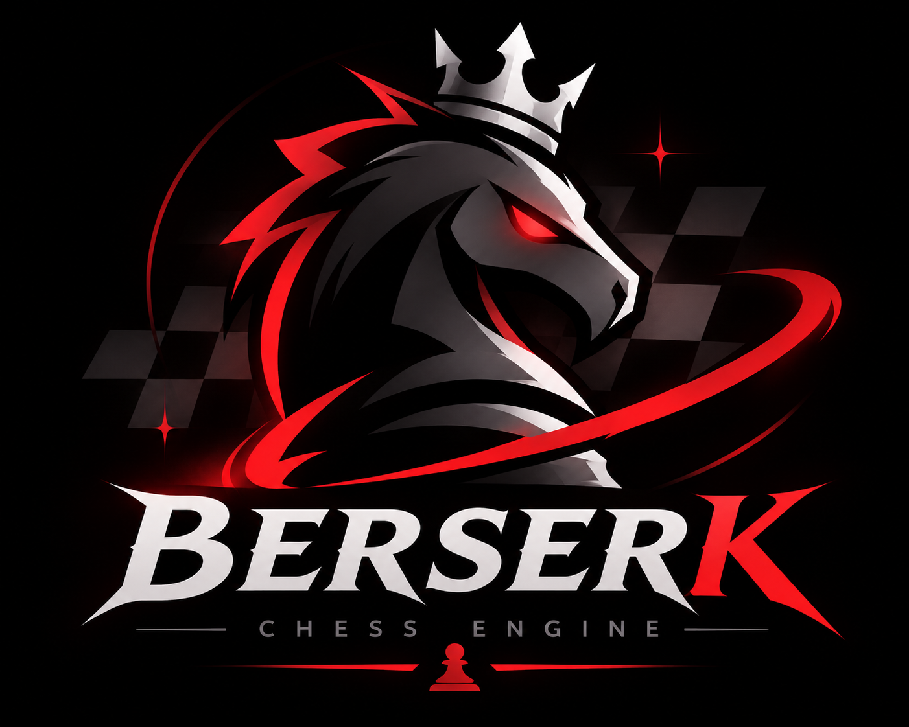

<p align="center">
  
</p>

<h1 align="center">Berserk</h1>
<p align="center"><strong>A fast, open-source chess engine written in Rust</strong></p>

<p align="center">
  <a href="https://github.com/official-knightly/Berserk/releases"></a>
  <a href="https://github.com/official-knightly/Berserk/blob/main/LICENSE"></a>
  
</p>

---

## About

Berserk is a UCI-compatible chess engine built for strength and speed. It uses a neural network evaluation (NNUE), multi-threading, optional Syzygy endgame tablebases, and SIMD acceleration (AVX2 / AVX-512 / NEON / WASM). If you want engine.ts scroll down 

This software is completely free — released into the public domain under the [Unlicense](LICENSE). You can do anything with it.

---

## Features

- **NNUE evaluation** — neural network with incremental accumulator updates
- **Multi-threaded search** — lazy SMP with NUMA-aware thread pinning
- **Syzygy tablebases** — via Fathom (optional, enabled by default)
- **SIMD acceleration** — AVX2, AVX-512, NEON, and WebAssembly SIMD
- **UCI protocol** — compatible with any UCI-capable chess GUI
- **Chess960 (FRC)** — full Fisher Random Chess support
- **WebAssembly** — can be compiled and run in a browser

---

## Building

### Requirements

- [Rust](https://rustup.rs/) (stable)
- `clang` (required for Syzygy support)

### Quick build

```sh
cargo build --release
```

### Using the Makefile

```sh
make           # native build
make no-syzygy # build without Syzygy support
make pgo       # profile-guided optimisation build
make wasm      # WebAssembly target
make checkdeps # verify all build dependencies
```

The output binary will be named `berserk` (or `berserk.exe` on Windows).

---

## Usage

Run directly as a UCI engine from any chess GUI (Arena, CuteChess, BankSia, etc.), or from the command line:

```sh
./berserk
```

### UCI Options

| Option | Type | Default | Description |
|---|---|---|---|
| `Hash` | spin | 64 MB | Transposition table size in MB |
| `Threads` | spin | 1 | Number of search threads |
| `MoveOverhead` | spin | 100 ms | Time buffer for move delivery |
| `MultiPV` | spin | 1 | Number of PV lines to report |
| `UCI_Chess960` | check | false | Enable Chess960 castling rules |
| `SyzygyPath` | string | — | Path to Syzygy tablebase files |
| `Minimal` | check | false | Minimal UCI output mode |

### Extra Commands

```
bench        run built-in benchmark
eval         show NNUE piece contributions for current position
d            display the current board
perft <n>    run perft to depth n
compiler     show compiler/target info
```

---

## Project Structure

```
src/
├── board/        move generation, make/unmake, parser, SEE
├── nnue/         accumulator, SIMD forward pass, output buckets
├── types/        bitboard, moves, pieces, squares, zobrist keys
├── tools/        bench, perft, speedtest
├── search.rs     main alpha-beta search
├── evaluation.rs classical eval helpers
├── uci.rs        UCI protocol handler
├── threadpool.rs lazy SMP thread management
├── time.rs       time management
└── transposition.rs  hash table
deps/
└── Fathom        Syzygy tablebase probing (C)
build/
└── build.rs      compile-time attack table & network generation
```

---

## License

This is free and unencumbered software released into the public domain.  
See [LICENSE](LICENSE) for full details — or visit [unlicense.org](https://unlicense.org).

## Downloads

Download prebuilt engine files from the [Berserk Downloads page](https://github.com/official-knightly/Berserk/releases/tag/downloads). This is an automated downloads release (currently marked as a prerelease), so the standard “latest stable release” badge may say no release is available even though these files exist:

- **Windows x64:** `berserk-windows-x64.exe` is the standalone UCI engine binary. Select this file directly in a UCI-compatible chess GUI or tournament manager (including engine championship software). `berserk-windows-x64.zip` also includes `berserk.exe`, the license, and instructions.
- **Linux x64 and macOS:** standalone native engine binaries are provided alongside the `.tar.gz` packages for Linux x64, macOS Intel, and macOS Apple Silicon.
- **Web apps:** `berserk-wasm-js.zip` includes `berserk.js` and `berserk_bg.wasm` for local browser integration.
- **Full source:** clone or download this repository to build or integrate the engine yourself.

The downloadable builds are generated by GitHub Actions from the source in this repository. If an asset link does not work, check the [build workflow](https://github.com/official-knightly/Berserk/actions/workflows/build-downloads.yml) and the [published download assets](https://github.com/official-knightly/Berserk/releases/tag/downloads).

WebAssembly note: keep `berserk.js` and `berserk_bg.wasm` together and serve them over HTTP(S). The current wrapper is synchronous, so use a Web Worker to keep a website's UI responsive.

The browser WebAssembly files are also checked into [`wasm/browser/`](wasm/browser/). The [browser WASM workflow](.github/workflows/build-wasm.yml) regenerates them from the Rust engine source.


---

## TypeScript adapter for browser integrations

For a web application that uses the Berserk WebAssembly build, the following TypeScript adapter provides a promise-based API for loading the worker, tracking initialization progress, and requesting engine searches. It supports MultiPV candidate lines and serializes searches because the WASM search runs synchronously inside the worker.

Save this code as engine.ts in the consuming TypeScript project:

~~~ts
export const WASM_URL =
  "https://media.githubusercontent.com/media/official-knightly/Berserk-web/main/engine/berserk_bg.wasm";

export type Candidate = {
  rank: number;
  depth: number;
  uci: string;
  pv: string[];
  scoreCp: number;
  mate: number | null;
};

export type SearchResult = {
  bestmove: string;
  scoreCp: number;
  depth: number;
  nodes: string;
  candidates: Candidate[];
};

export type EngineStatus = "idle" | "loading" | "ready" | "error";

type Listener = (s: {
  status: EngineStatus;
  progress: number;
  error?: string;
}) => void;

class BerserkEngine {
  private worker: Worker | null = null;
  private pending = new Map<
    number,
    {
      resolve: (r: SearchResult) => void;
      reject: (e: Error) => void;
    }
  >();
  private seq = 0;
  private queue: Promise<unknown> = Promise.resolve();

  status: EngineStatus = "idle";
  progress = 0;
  error?: string;
  private listeners = new Set<Listener>();
  ready!: Promise<void>;

  subscribe(fn: Listener) {
    this.listeners.add(fn);
    fn({
      status: this.status,
      progress: this.progress,
      error: this.error,
    });
    return () => this.listeners.delete(fn);
  }

  private emit() {
    this.listeners.forEach((listener) =>
      listener({
        status: this.status,
        progress: this.progress,
        error: this.error,
      }),
    );
  }

  start() {
    if (this.worker || typeof window === "undefined") return this.ready;

    this.status = "loading";
    this.emit();

    this.ready = new Promise<void>((resolve, reject) => {
      const worker = new Worker("/engine/engine-worker.js", {
        type: "module",
        name: "Berserk-WASM",
      });

      this.worker = worker;

      worker.onmessage = (event) => {
        const message = event.data || {};

        if (message.type === "ready") {
          this.status = "ready";
          this.progress = 1;
          this.emit();
          resolve();
        } else if (message.type === "progress") {
          this.progress = message.total
            ? message.loaded / message.total
            : Math.min(0.95, message.loaded / 64_000_000);
          this.emit();
        } else if (message.type === "init-error") {
          this.fail(message.error || "Berserk WASM initialization failed.");
          reject(new Error(this.error));
        } else if (
          message.type === "result" ||
          message.type === "search-error"
        ) {
          const pending = this.pending.get(message.id);
          if (!pending) return;

          this.pending.delete(message.id);

          if (message.type === "search-error") {
            pending.reject(new Error(message.error));
          } else {
            pending.resolve(message as SearchResult);
          }
        }
      };

      worker.onerror = (event) => {
        this.fail(event.message || "Berserk worker failed.");
        reject(new Error(this.error));
      };

      worker.postMessage({ type: "init", wasmUrl: WASM_URL });
    });

    this.ready.catch(() => {});
    return this.ready;
  }

  private fail(message: string) {
    this.status = "error";
    this.error = message;
    this.emit();

    this.pending.forEach((pending) =>
      pending.reject(new Error(message)),
    );
    this.pending.clear();
  }

  /** Searches are serialized because WASM search is synchronous in the worker. */
  search(
    fen: string,
    milliseconds: number,
    multiPV = 1,
  ): Promise<SearchResult> {
    const run = async () => {
      await this.start();

      if (!this.worker) {
        throw new Error("Berserk worker is unavailable.");
      }

      const id = ++this.seq;

      return new Promise<SearchResult>((resolve, reject) => {
        this.pending.set(id, { resolve, reject });

        this.worker!.postMessage({
          type: "search",
          id,
          fen,
          milliseconds: Math.max(
            100,
            Math.min(10_000, Math.round(milliseconds)),
          ),
          multiPV: Math.max(1, Math.min(8, Math.round(multiPV))),
        });
      });
    };

    const result = this.queue.then(run, run);
    this.queue = result.catch(() => {});
    return result;
  }
}

export const engine = new BerserkEngine();
~~~

### Usage

~~~ts
import { engine } from "./engine";

engine.subscribe(({ status, progress, error }) => {
  console.log("Berserk:", status, Math.round(progress * 100) + "%", error);
});

const result = await engine.search(
  "rnbqkbnr/pppppppp/8/8/8/8/PPPPPPPP/RNBQKBNR w KQkq - 0 1",
  1000,
  3,
);

console.log("Best move:", result.bestmove);
console.log("Candidate lines:", result.candidates);
~~~

### Required worker files and download

The adapter expects /engine/engine-worker.js to be served by the consuming website. The worker must understand the init, progress, ready, init-error, search, result, and search-error messages used above. The WASM binary is fetched from the GitHub LFS media URL in WASM_URL; keep the matching JavaScript WASM loader and binary together when packaging a local copy.

The official browser WASM JavaScript and binary are available in the [Berserk Downloads release](https://github.com/official-knightly/Berserk/releases/tag/downloads), as berserk-wasm-js.zip, and in [wasm/browser/](wasm/browser/). This adapter does not itself download or extract that ZIP: it loads the worker and requests the WASM URL. A project that wants to use the ZIP locally must download/extract it and point its worker at the extracted berserk.js and berserk_bg.wasm.

Serve the website over HTTP(S), not by opening the HTML file directly. The WASM search is synchronous inside the worker, so keep searches serialized and time limits bounded.
