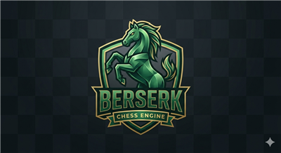

<p align="center">
  
</p>

<h1 align="center">Berserk</h1>
<p align="center"><strong>A fast, open-source chess engine written in Rust</strong></p>

<p align="center">
  <a href="https://github.com/official-knightly/Berserk/releases"></a>
  <a href="https://github.com/official-knightly/Berserk/blob/main/LICENSE"></a>
  
</p>

---

## About

Berserk is a UCI-compatible chess engine built for strength and speed. It uses a neural network evaluation (NNUE), multi-threading, optional Syzygy endgame tablebases, and SIMD acceleration (AVX2 / AVX-512 / NEON / WASM).

This software is completely free — released into the public domain under the [Unlicense](LICENSE). You can do anything with it.

---

## Features

- **NNUE evaluation** — neural network with incremental accumulator updates
- **Multi-threaded search** — lazy SMP with NUMA-aware thread pinning
- **Syzygy tablebases** — via Fathom (optional, enabled by default)
- **SIMD acceleration** — AVX2, AVX-512, NEON, and WebAssembly SIMD
- **UCI protocol** — compatible with any UCI-capable chess GUI
- **Chess960 (FRC)** — full Fisher Random Chess support
- **WebAssembly** — can be compiled and run in a browser

---

## Building

### Requirements

- [Rust](https://rustup.rs/) (stable)
- `clang` (required for Syzygy support)

### Quick build

```sh
cargo build --release
```

### Using the Makefile

```sh
make           # native build
make no-syzygy # build without Syzygy support
make pgo       # profile-guided optimisation build
make wasm      # WebAssembly target
make checkdeps # verify all build dependencies
```

The output binary will be named `berserk` (or `berserk.exe` on Windows).

---

## Usage

Run directly as a UCI engine from any chess GUI (Arena, CuteChess, BankSia, etc.), or from the command line:

```sh
./berserk
```

### UCI Options

| Option | Type | Default | Description |
|---|---|---|---|
| `Hash` | spin | 64 MB | Transposition table size in MB |
| `Threads` | spin | 1 | Number of search threads |
| `MoveOverhead` | spin | 100 ms | Time buffer for move delivery |
| `MultiPV` | spin | 1 | Number of PV lines to report |
| `UCI_Chess960` | check | false | Enable Chess960 castling rules |
| `SyzygyPath` | string | — | Path to Syzygy tablebase files |
| `Minimal` | check | false | Minimal UCI output mode |

### Extra Commands

```
bench        run built-in benchmark
eval         show NNUE piece contributions for current position
d            display the current board
perft <n>    run perft to depth n
compiler     show compiler/target info
```

---

## Project Structure

```
src/
├── board/        move generation, make/unmake, parser, SEE
├── nnue/         accumulator, SIMD forward pass, output buckets
├── types/        bitboard, moves, pieces, squares, zobrist keys
├── tools/        bench, perft, speedtest
├── search.rs     main alpha-beta search
├── evaluation.rs classical eval helpers
├── uci.rs        UCI protocol handler
├── threadpool.rs lazy SMP thread management
├── time.rs       time management
└── transposition.rs  hash table
deps/
└── Fathom        Syzygy tablebase probing (C)
build/
└── build.rs      compile-time attack table & network generation
```

---

## License

This is free and unencumbered software released into the public domain.  
See [LICENSE](LICENSE) for full details — or visit [unlicense.org](https://unlicense.org).


---

## Optional HTTP API (folder: `api/`)

This repository now includes a standalone HTTP service that runs the **existing native Berserk engine** behind a small JSON API. The engine source, Cargo manifest in Git, and existing project layout are not changed by adding this service. The API can be deployed independently from the chess website.

### Endpoints

- `GET /` — service overview
- `GET /api/v1` — API v1 information and canonical endpoint list
- `GET /api/v1/health` — health check for the engine API
- `POST /api/v1/analyze` — analyse a FEN and return Berserk's best move plus the MultiPV candidate lines
- `GET /health` and `POST /api/analyze` — backwards-compatible aliases
- `GET /client.js` — optional browser adapter

Example request:

```json
{
  "fen": "rnbqkbnr/pppppppp/8/8/8/8/PPPPPPPP/RNBQKBNR w KQkq - 0 1",
  "think_time_ms": 1000,
  "multi_pv": 3,
  "threads": 1,
  "context": 1
}
```

`think_time_ms` is limited to 100–10,000 ms, `multi_pv` to 1–8, and `threads` to 1–2. The response includes `bestmove`, `scoreCp`, `depth`, `nodes`, `candidates`, and the optional `context` value. Each candidate contains `rank`, `depth`, `uci`, `pv`, `scoreCp`, and `mate`.

### Run locally with Docker

Run these commands from the **repository root** (not from inside `api/`):

```sh
docker build -f api/Dockerfile -t berserk-api .
docker run --rm -p 10000:10000 -e PORT=10000 berserk-api
```

Health check: `http://localhost:10000/api/v1/health`

Try a search:

```sh
curl -X POST http://localhost:10000/api/v1/analyze \
  -H 'Content-Type: application/json' \
  -d '{"fen":"rnbqkbnr/pppppppp/8/8/8/8/PPPPPPPP/RNBQKBNR w KQkq - 0 1","think_time_ms":1000,"multi_pv":3}'
```

Interactive API docs are available at `http://localhost:10000/docs`.

### Canonical API URL (v1)

**The official Berserk API base URL is:**

```text
https://berserk/api/v1
```

All integrations should use this single base URL. Endpoints are:

| Method | Endpoint | Purpose |
|---|---|---|
| GET | `https://berserk/api/v1` | API information |
| GET | `https://berserk/api/v1/health` | Health check |
| POST | `https://berserk/api/v1/analyze` | Analyze a FEN position |

Send JSON to `/analyze`, for example:

```json
{
  "fen": "rnbqkbnr/pppppppp/8/8/8/8/PPPPPPPP/RNBQKBNR w KQkq - 0 1",
  "think_time_ms": 1000,
  "multi_pv": 3,
  "threads": 1
}
```

For local Docker testing, use `http://localhost:10000/api/v1` as the base URL.

### Hosting and domain routing

The API service is built from this repository's `api/Dockerfile`. To make the canonical URL work publicly, deploy the Docker service on a container-capable host and configure public DNS, HTTPS/TLS, and host routing for the hostname `berserk` so requests reach the running API service while preserving `/api/v1/*` paths. The canonical URL is the integration contract; the hosting provider's internal service URL should not be substituted into client integrations.

**Important:** the source code now exposes the v1 routes, but the URL is only reachable from the public internet once the `berserk` hostname has valid public DNS/TLS and is routed to the running API service. Do not assume deployment or DNS is already configured.

### Connecting Berserk-web

Berserk-web and any third-party site should use the same canonical base URL, `https://berserk/api/v1`, and call `/health` and `/analyze` relative to that base. The website's own hosting domain is separate from the engine API domain.
The API enables CORS by default so a static site can call it. For a public deployment, set `ALLOWED_ORIGINS` to your actual website origin where supported, and apply hosting rate limits; the endpoint uses CPU to run searches and is not intended to be an unrestricted public engine farm.
